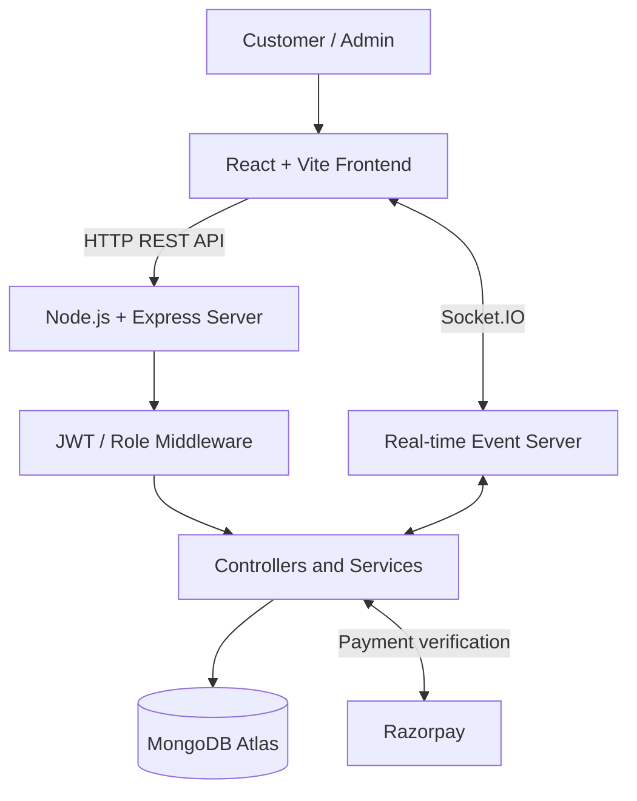

<div align="center">

# 🍟 BetaSnacks
### Snack Smart. Order Fast.

**A full-stack food ordering platform with real-time order tracking and restaurant operations management.**

[](https://react.dev/)
[](https://vite.dev/)
[](https://nodejs.org/)
[](https://expressjs.com/)
[](https://www.mongodb.com/)
[](https://socket.io/)
[](https://razorpay.com/)

[Overview](#-overview) • [Features](#-features) • [Tech Stack](#-technology-stack) • [Getting Started](#-getting-started) • [API](#-api-overview) • [Author](#-author)

</div>

---

## 📌 Overview

**BetaSnacks** is a full-stack food ordering and restaurant management application built to provide customers with a smooth online ordering experience while helping restaurant teams manage menus, orders, promotions, and kitchen operations.

The platform combines a responsive React storefront with a Node.js and Express backend. MongoDB is used for data persistence, while Socket.IO enables real-time order status updates. Customers can choose between online Razorpay payments and Cash on Delivery.

> **Project:** CodeAlpha Internship — Task 1  
> **Category:** Full-Stack Web Development

## ✨ Features

### 🛍️ Customer experience
- Browse food items through a categorized menu.
- Search, filter, and sort dishes.
- View dish details, customizations, and availability.
- Add items to a cart and calculate totals dynamically.
- Apply promotional coupon codes.
- Checkout using Razorpay or Cash on Delivery.
- Track order progress with real-time status updates.
- Save favorite dishes to a wishlist.
- Manage profile details, delivery addresses, and order history.
- View loyalty reward points.

### 🧑‍🍳 Restaurant administration
- View business metrics and order statistics.
- Monitor incoming orders through a live kitchen feed.
- Accept orders and update preparation/delivery stages.
- Add, edit, and remove menu items.
- Manage dish prices, images, stock, and availability.
- Create and manage promotional coupons.
- View customer information and order history.

### 🔐 Security and reliability
- JWT-based authentication and role-based access.
- Password hashing with bcrypt.
- Server-side Razorpay signature verification.
- Protected customer and admin routes.
- Request validation and centralized error handling.
- React error boundary for graceful UI error recovery.
- Database fallback behavior as implemented in the project.

## 🧰 Technology Stack

| Area | Technologies |
|---|---|
| Frontend | React 19, Vite, React Router |
| Styling | Tailwind CSS, PostCSS |
| UI and charts | Lucide React, Recharts |
| Backend | Node.js, Express.js |
| Database | MongoDB Atlas, Mongoose |
| Real-time communication | Socket.IO |
| Authentication | JWT, bcrypt |
| Payments | Razorpay |
| Notifications | React Hot Toast |
| Development tools | Git, npm |

## 🏛️ System Architecture



## 📂 Project Structure

```text
betasnacks/
├── backend/
│   ├── config/          # Database and cloud configuration
│   ├── controllers/     # Request handlers
│   ├── middleware/      # Authentication and error middleware
│   ├── models/          # Mongoose schemas
│   ├── routes/          # REST API routes
│   ├── services/        # Payment and real-time services
│   ├── seed/            # Sample data seeding
│   ├── utils/           # Helper utilities
│   ├── server.js        # Backend entry point
│   └── .env.example
├── frontend/
│   ├── public/          # Static assets
│   ├── src/
│   │   ├── components/  # Reusable UI components
│   │   ├── context/     # Global application state
│   │   ├── layouts/     # Page layouts
│   │   ├── pages/       # Customer, auth, and admin pages
│   │   ├── router/      # Route protection
│   │   ├── services/    # API client and service calls
│   │   ├── utils/       # Formatters and validators
│   │   ├── App.jsx
│   │   └── main.jsx
│   └── .env.example
├── .gitignore
└── README.md
```

*The structure above is based on the project layout; adjust it if your repository differs.*

## 🚀 Getting Started

### Prerequisites

- Node.js 20 or later
- npm
- Git
- MongoDB connection string (if using MongoDB Atlas)
- Razorpay test credentials (for testing online payments)

### 1. Clone the repository

```bash
git clone https://github.com/newayushgupta/betasnacks.git
cd betasnacks
```

### 2. Configure and run the backend

```bash
cd backend
npm install
```

Create a `.env` file in the `backend` directory using `.env.example` as a reference.

Example configuration:

```env
PORT=5000
MONGODB_URI=your_mongodb_connection_string
JWT_SECRET=replace_with_a_long_random_secret
JWT_EXPIRES_IN=7d
FRONTEND_URL=http://localhost:5173
RAZORPAY_KEY_ID=your_razorpay_test_key_id
RAZORPAY_KEY_SECRET=your_razorpay_test_key_secret
```

If your project includes a seed script, load sample data:

```bash
npm run seed
```

Start the backend:

```bash
npm run dev
```

The backend should be available at `http://localhost:5000`.

### 3. Configure and run the frontend

Open a second terminal:

```bash
cd frontend
npm install
```

Create a `.env` file in the `frontend` directory:

```env
VITE_API_URL=http://localhost:5000/api
VITE_SOCKET_URL=http://localhost:5000
VITE_RAZORPAY_KEY_ID=your_razorpay_test_key_id
```

Start the frontend:

```bash
npm run dev
```

Open `http://localhost:5173` in your browser.

> Keep real credentials in local environment files. Never commit `.env` files, private API keys, payment secrets, or production credentials to GitHub.

## 🔌 API Overview

The backend exposes REST endpoints grouped by feature. The exact routes may depend on the current implementation.

| Module | Example endpoints | Purpose |
|---|---|---|
| Authentication | `/api/auth` | Registration, login, and profile |
| Products | `/api/products` | Menu browsing and product management |
| Cart | `/api/cart` | Cart operations |
| Coupons | `/api/coupons` | Coupon validation |
| Orders | `/api/orders` | Order creation, history, and status |
| Payments | `/api/payment` | Payment order creation and verification |

For endpoint methods, request bodies, and access permissions, refer to the route files in `backend/routes/`.

## 💳 Payment Testing

BetaSnacks supports Razorpay integration and Cash on Delivery. Use Razorpay **test mode** credentials while developing. Payment verification should be performed on the backend; never expose the Razorpay secret key in frontend code or commit it to the repository.

## 🖼️ Screenshots

Add screenshots of your actual application here to make the repository easier to review.

```text
screenshots/
├── home-page.png
├── menu-page.png
├── cart-checkout.png
├── order-tracking.png
└── admin-dashboard.png
```

Example Markdown once screenshots are added:

```md

```

## 🧪 Future Improvements

- Add automated frontend and backend tests.
- Add CI checks for linting and build validation.
- Improve accessibility and keyboard navigation.
- Add order notifications through email or SMS.
- Add deployment links and a live demo walkthrough.

## 👨‍💻 Author

**Ayush Gupta**

- GitHub: [@newayushgupta](https://github.com/newayushgupta)
- Email: newayushgupta@gmail.com

## 🎓 Internship

This project is submitted as part of **CodeAlpha — Task 1**.

## 📄 License

This project is distributed under the MIT License. If you include a `LICENSE` file in the repository, see that file for the full license terms.

---

<div align="center">

**Built with ❤️ by Ayush Gupta**

*BetaSnacks — Snack Smart. Order Fast.*

</div>
