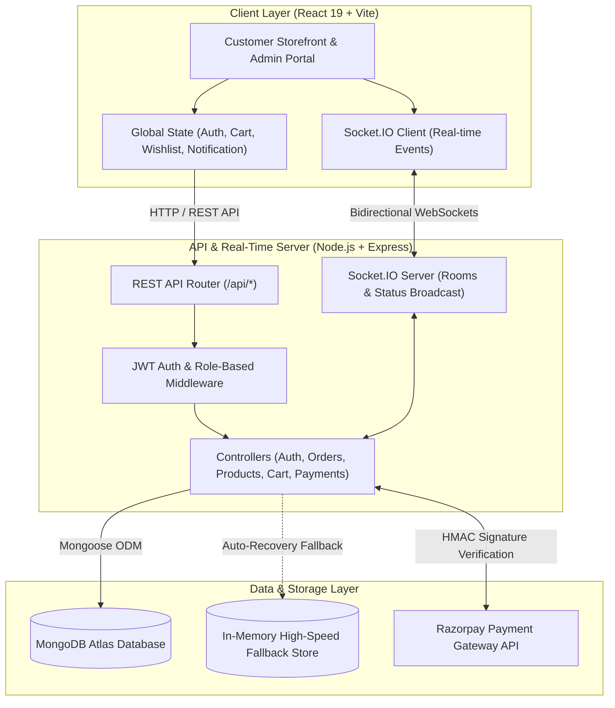

<div align="center">

# 🍟 BETASNACKS
### *Snack Smart. Order Fast.*

**A production-ready, full-stack gourmet restaurant e-commerce platform & real-time kitchen operations suite.**

[](https://nodejs.org/)
[](https://react.dev/)
[](https://vitejs.dev/)
[](https://tailwindcss.com/)
[](https://www.mongodb.com/atlas)
[](https://socket.io/)
[](https://razorpay.com/)
[](LICENSE)

[Features](#-key-features) • [Architecture](#-system-architecture) • [Tech Stack](#-technology-stack) • [Quick Start](#-quick-start-guide) • [API Reference](#-rest-api-documentation) • [Admin Suite](#-restaurant-admin-portal)

---

</div>

## 📖 Overview

**Betasnacks** is a modern, enterprise-style food delivery and kitchen management platform designed to deliver high-performance user experiences for customers and seamless order management for restaurants. 

Engineered with **React 19**, **Express.js REST APIs**, **MongoDB Atlas**, and real-time bidirectional **Socket.IO WebSockets**, Betasnacks features responsive layouts, zero-friction checkout, dual payment modes (Razorpay Online + Cash on Delivery), and live order status streaming.

---

## 🌟 Key Features

### 🛒 Customer Storefront
- **🎨 Modern Warm Aesthetic**: Soft peach-orange gradient palette (`#FFFBF7` → `#FFEBD9`) with high-contrast typography, smooth micro-animations, and complete mobile responsiveness with zero horizontal overflow.
- **🔍 Smart Search & Categorized Menu**: Filter by cuisine (Chaat, South Indian, Artisanal Pizza, Hakka Bowls), toggle pure-veg, filter by price range, and sort by rating/popularity.
- **🍲 Dish Detail & Recipe Customizer**: High-resolution photography, customizable portions, spice levels, add-on dips, nutritional metrics, and live stock indicators.
- **🛍️ Reactive Cart & Dynamic Pricing**: Real-time subtotal computation, progressive free-delivery meter, itemized packaging & GST calculation, and coupon discount engine.
- **💳 Multi-Method Checkout**:
  - **Razorpay Online Payments**: HMAC-SHA256 server-verified digital payments with seamless test-mode sandbox fallback.
  - **Cash on Delivery (COD)**: Instant frictionless ordering with immediate kitchen confirmation.
- **📍 Real-Time Live Order GPS Tracking**: Live visual pipeline (*Placed → Confirmed → Preparing → Out for Delivery → Delivered*) powered by Socket.IO events and estimated delivery countdown.
- **❤️ Wishlist & Saved Cravings**: One-click dish bookmarking with persistent storage and instant add-to-cart.
- **👤 Customer Account Portal**: Multi-address manager with default tagging, order history records, profile editing, and **Betasnacks Loyalty Reward Points** tracking.

---

### 👑 Restaurant Admin Portal
- **📊 Business Analytics & KPI Dashboard**: Monthly gross revenue trends with interactive Recharts, order volume metrics, customer retention, and top-selling dishes.
- **🍳 Live Kitchen Operations Feed**: Real-time order pipeline stream. Kitchen staff can accept orders, update preparation stages, and broadcast instant updates to customer devices via WebSockets.
- **📦 Comprehensive Menu Management**: Add, update, or remove dishes; modify prices, upload photos, toggle stock availability, and manage preparation times.
- **🎟️ Promotional Campaign Manager**: Create percentage-based or flat cash discount coupons, configure validity dates, minimum order requirements, and usage caps.
- **👥 Customer Directory**: View registered customer profiles, order history, contact information, and loyalty point balances.

---

## 🏗️ System Architecture



---

## 🛠️ Technology Stack

| Layer | Technologies |
|---|---|
| **Frontend Framework** | React 19, Vite 8, React Router DOM v7 |
| **Styling & Design** | Tailwind CSS v3.4, Lucide React Icons, PostCSS |
| **Data Visualization** | Recharts (Monthly revenue trends, dish analytics) |
| **Backend Runtime** | Node.js (v20+ / v25), Express.js RESTful API |
| **Real-time WebSockets** | Socket.IO (v4.8) with order room isolation |
| **Database & ODM** | MongoDB Atlas, Mongoose ODM (with non-blocking buffer protection) |
| **Authentication & Security**| JWT (JSON Web Tokens), bcryptjs password hashing, Helmet, CORS, Rate-Limiting |
| **Payment Gateway** | Razorpay Node.js SDK (with HMAC-SHA256 signature verification) |
| **Notifications** | React Hot Toast, Custom Socket Alert Dispatcher |

---

## 📁 Repository Structure

```text
betasnacks/
├── backend/
│   ├── config/             # MongoDB Atlas connection & Cloudinary setup
│   ├── controllers/        # Express route controllers (auth, cart, order, product, payment)
│   ├── middleware/         # JWT protect, role guards, file upload, error handlers
│   ├── models/             # 10 Mongoose schemas (User, Product, Order, Coupon, Cart, etc.)
│   ├── routes/             # RESTful endpoint routes
│   ├── services/           # Socket.IO dispatcher, Razorpay payment & email services
│   ├── seed/               # High-fidelity mock seed data generator
│   ├── utils/              # Calculation helpers, API response wrappers, fallback memory store
│   ├── server.js           # Server bootstrap & WebSocket initialization
│   ├── package.json
│   └── .env.example        # Environment variable template
│
├── frontend/
│   ├── public/             # Brand logos, icons, dish photography assets
│   ├── src/
│   │   ├── components/
│   │   │   ├── common/     # Navbar, Footer, Logo, ProductCard, ErrorBoundary, Modals
│   │   │   ├── home/       # HeroSection, CategorySection, Bestsellers, Offers
│   │   │   ├── cart/       # CartItem, CartSummary
│   │   │   └── order/      # OrderStatusTimeline, OrderCard
│   │   ├── context/        # AuthContext, CartContext, WishlistContext, NotificationContext
│   │   ├── layouts/        # CustomerLayout, AdminLayout, AuthLayout
│   │   ├── pages/
│   │   │   ├── customer/   # HomePage, MenuPage, ProductDetailPage, CartPage, CheckoutPage, OrderTrackingPage, ProfilePage, WishlistPage
│   │   │   ├── auth/       # LoginPage, RegisterPage, ForgotPasswordPage
│   │   │   └── admin/      # AdminDashboard, Products, Orders, Customers, Coupons, Categories
│   │   ├── router/         # ProtectedRoute (Role-aware route guards)
│   │   ├── services/       # Axios API client & endpoints
│   │   ├── utils/          # Formatters, constants, validators
│   │   ├── App.jsx         # Global routing tree
│   │   └── main.jsx        # App mounting with React ErrorBoundary
│   ├── tailwind.config.js
│   ├── package.json
│   └── .env.example
├── .gitignore              # Ignores .env, node_modules, build artifacts
└── README.md
```

---

## ⚡ Quick Start Guide

### Prerequisites
- [Node.js](https://nodejs.org/) (v18.x or higher)
- [Git](https://git-scm.com/)
- MongoDB Atlas cluster URI (optional — auto-switches to in-memory store if offline)

---

### 1. Clone the Repository
```bash
git clone https://github.com/<YOUR_GITHUB_USERNAME>/betasnacks.git
cd betasnacks
```

---

### 2. Backend Setup
```bash
cd backend
npm install

# Copy environment file
cp .env.example .env
```

Review or edit `backend/.env`:
```env
PORT=5000
MONGODB_URI=mongodb+srv://<username>:<password>@cluster0.mongodb.net/betasnacks?retryWrites=true&w=majority
JWT_SECRET=betasnacks_production_secret_jwt_key_987654321
JWT_EXPIRES_IN=7d
FRONTEND_URL=http://localhost:5173
RAZORPAY_KEY_ID=rzp_test_betasnacks123
RAZORPAY_KEY_SECRET=betasnacks_test_secret_key
```

#### Run Database Seed (25+ Gourmet Dishes, Categories, Admin & Coupons)
```bash
npm run seed
```

#### Start Backend API Server
```bash
# Development mode with hot-reload
npm run dev

# Or standard production mode
npm start
```
*Backend will run on `http://localhost:5000`.*

---

### 3. Frontend Setup
In a new terminal window:
```bash
cd frontend
npm install

# Copy frontend environment file
cp .env.example .env
```

Review `frontend/.env`:
```env
VITE_API_URL=http://localhost:5000/api
VITE_SOCKET_URL=http://localhost:5000
VITE_RAZORPAY_KEY_ID=rzp_test_betasnacks123
```

#### Start Frontend Client
```bash
npm run dev
```
*Frontend will launch at `http://localhost:5173`.*

---

## 🔑 Demo Accounts

Quick demo login buttons are provided directly on the `/auth/login` page:

| Role | Name | Email | Password | Access Rights |
|---|---|---|---|---|
| **Admin Chef** | Admin Chef | `admin@betasnacks.com` | `Admin@123` | Full Admin Dashboard, Catalog & Kitchen Management |
| **Customer** | Ayush Gupta | `customer@betasnacks.com` | `Password123!` | Storefront, Menu, Cart, COD & Razorpay Checkout, Orders |
| **Customer** | Rahul Sharma | `rahul@example.com` | `Customer@123` | Storefront, Wishlist, Reward Points |

---

## 🎟️ Active Promotional Coupons

| Coupon Code | Discount | Minimum Cart | Description |
|---|---|---|---|
| `BETASNACKS20` | **20% OFF** (Max ₹100) | ₹199 | Welcome bonus on first gourmet order |
| `WELCOME50` | **Flat ₹50 OFF** | ₹149 | Special discount on evening desi chaat |
| `TASTY100` | **Flat ₹100 OFF** | ₹499 | Party snack discount for bulk orders |

---

## 📡 REST API Documentation

### 🔐 Authentication (`/api/auth`)
| Method | Endpoint | Description | Access |
|---|---|---|---|
| `POST` | `/api/auth/register` | Register new customer with name & password | Public |
| `POST` | `/api/auth/login` | Authenticate customer or admin, return JWT | Public |
| `GET` | `/api/auth/profile` | Fetch authenticated user profile & addresses | Private |
| `PUT` | `/api/auth/profile` | Update profile details and delivery spots | Private |
| `POST` | `/api/auth/addresses` | Add a new saved delivery address | Private |

### 🍔 Menu & Products (`/api/products`)
| Method | Endpoint | Description | Access |
|---|---|---|---|
| `GET` | `/api/products` | Paginated product search, category & veg filter | Public |
| `GET` | `/api/products/bestsellers` | Retrieve top trending food dishes | Public |
| `GET` | `/api/products/:id` | Get individual dish recipe, ingredients & details | Public |
| `POST` | `/api/products` | Create a new food catalog dish | Admin |
| `PUT` | `/api/products/:id` | Edit price, availability, stock, customizations | Admin |
| `DELETE` | `/api/products/:id` | Remove dish from catalog | Admin |

### 🛒 Cart & Coupons (`/api/cart`, `/api/coupons`)
| Method | Endpoint | Description | Access |
|---|---|---|---|
| `GET` | `/api/cart` | Get current user's synced cart | Private |
| `POST` | `/api/cart` | Add product to cart with metadata snapshot | Private |
| `PUT` | `/api/cart/:itemId` | Update quantity of cart item | Private |
| `DELETE` | `/api/cart/:itemId` | Remove item from cart | Private |
| `POST` | `/api/coupons/validate`| Check coupon code eligibility & calculate discount | Private |

### 📦 Orders & Tracking (`/api/orders`)
| Method | Endpoint | Description | Access |
|---|---|---|---|
| `POST` | `/api/orders` | Place order (COD or Razorpay) | Private |
| `GET` | `/api/orders/my-orders` | Fetch customer order history with pagination | Private |
| `GET` | `/api/orders/:id` | Get real-time status and delivery timeline | Private |
| `PUT` | `/api/orders/:id/status`| Update preparation stage & emit Socket event | Admin |
| `PUT` | `/api/orders/:id/cancel`| Customer cancel order | Private |

### 💳 Payment Verification (`/api/payment`)
| Method | Endpoint | Description | Access |
|---|---|---|---|
| `POST` | `/api/payment/create-order` | Generate Razorpay order ID (or sandbox fallback)| Private |
| `POST` | `/api/payment/verify` | Verify HMAC-SHA256 cryptographic payment signature | Private |

---

## 🛡️ Security & Resilience Highlights

1. **Robust Offline / Memory Fallback**:
   - Mongoose command buffering is explicitly disabled (`mongoose.set('bufferCommands', false)`). If MongoDB Atlas encounters network timeouts, requests respond instantly via an in-memory store without hanging.
2. **Defensive React Error Boundaries**:
   - The root application is shielded by `ErrorBoundary.jsx`, catching runtime render errors and offering instant recovery without white-screen crashes.
3. **Cryptographic Payment Integrity**:
   - Razorpay payment signatures are validated on the backend using HMAC-SHA256 hashing. Orders are marked `paid` only after cryptographic confirmation.
4. **Historical Price Snapshotting**:
   - Order items snapshot historical prices at the exact moment of order placement, preventing retroactive cart price alterations.
5. **Secure Authentication**:
   - Passwords salted with `bcryptjs` (rounds = 10) and signed with JSON Web Tokens (JWT) containing 7-day expiration.

---

## 🚀 Production Deployment

### Frontend Deployment (Vercel)
1. Push repository to GitHub.
2. Import repo on [Vercel](https://vercel.com).
3. Set **Root Directory** to `frontend`.
4. Configure Environment Variables:
   - `VITE_API_URL`: `https://your-backend.onrender.com/api`
   - `VITE_SOCKET_URL`: `https://your-backend.onrender.com`
   - `VITE_RAZORPAY_KEY_ID`: `rzp_test_...`
5. Click **Deploy**.

### Backend Deployment (Render)
1. Create a new **Web Service** on [Render](https://render.com).
2. Set **Root Directory** to `backend`.
3. Build Command: `npm install`
4. Start Command: `node server.js`
5. Configure Environment Variables (`NODE_ENV=production`, `PORT=10000`, `MONGODB_URI`, `JWT_SECRET`, `FRONTEND_URL`, `RAZORPAY_KEY_ID`, `RAZORPAY_KEY_SECRET`).
6. Click **Create Web Service**.

---

## 👨‍💻 Author

**Ayush Gupta**  
- GitHub: [@newayushgupta](https://github.com/newayushgupta)  
- Email: `newayushgupta@gmail.com`

---

## 📄 License

This project is licensed under the **MIT License** — see the [LICENSE](LICENSE) file for details.

<div align="center">
  <sub>Built with ❤️ & gourmet snacks by Ayush Gupta.</sub>
</div>
